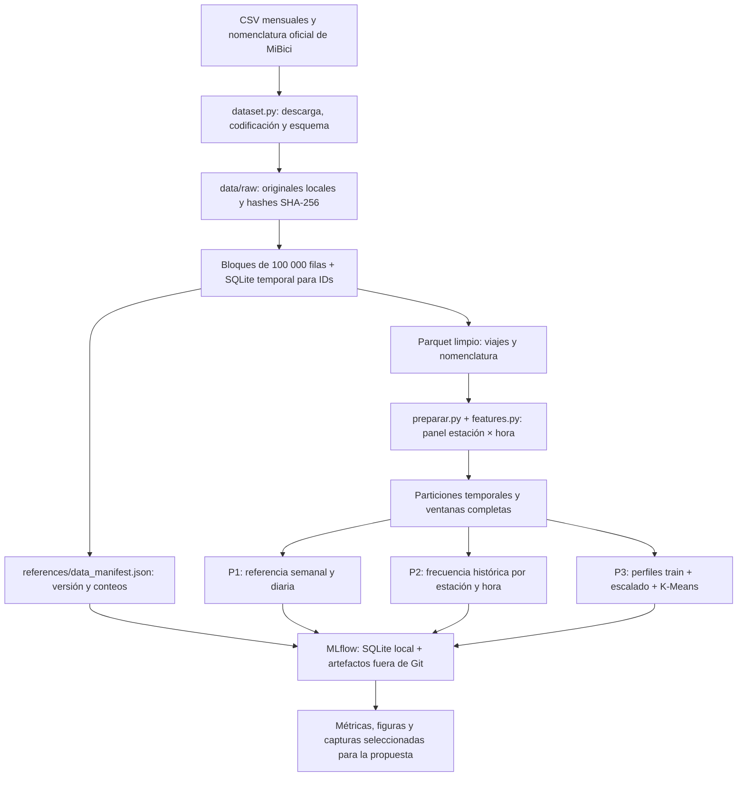

# Arquitectura y propuesta de Machine Learning · Equipo 27

Estado: diseño implementado en código; ejecución con datos reales pendiente de validación.

## Componentes y decisiones

| Componente | Herramienta | Justificación y límite |
| --- | --- | --- |
| Ingesta | requests con reintentos, timeout y descarga temporal | URLs explícitas en config; una respuesta HTML se rechaza. No depende de descargas manuales. |
| Preparación de viajes | pandas por bloques + SQLite temporal | Mantiene en memoria un bloque de viajes, no los doce meses. SQLite detecta duplicados globales y contradicciones entre bloques. No se afirma ejecución distribuida ni se requiere un clúster. |
| Almacenamiento | Parquet, PyArrow y compresión Zstandard | Esquema de columnas y fechas fijo, lectura por lotes y selección de columnas. Se procesan millones de filas con memoria acotada durante la ingesta. |
| Versionado | SHA-256 + manifiesto en Git | Fija los bytes originales, salidas, periodo, conteos y versión de transformación. Si la fuente cambia, se rechaza la reproducción. |
| Variables | pandas sobre panel agregado | El panel es menor que los viajes crudos, pero su tamaño depende de estaciones × horas; se debe medir la memoria al ejecutar. |
| Modelos | scikit-learn | Baselines interpretables y métricas reproducibles; semilla fijada. No se entrena un modelo complejo sin una referencia. |
| Experimentos | MLflow Tracking con SQLite | Parámetros, métricas, commit, versión de datos y figuras por run. La base y los artefactos se excluyen de Git. |
| Colaboración | Cookiecutter Data Science + Git/GitHub | Separación de código/datos/notebooks; revisión de cambios mediante PR. El README final documentará la ejecución verificada. |

## Datos y partición

Periodo propuesto: octubre de 2025 a septiembre de 2026. Cubre un ciclo anual,
lluvias, vacaciones y retorno a clases. La nomenclatura de septiembre de 2026 es
una fotografía reciente, no un inventario histórico de estaciones o capacidad.

Entrenamiento: hasta el 30 de junio de 2026. Validación: julio de 2026. Prueba:
agosto y septiembre de 2026. Los transformadores y las frecuencias se ajustan con
entrenamiento. El umbral de P2 se elige en validación; prueba se utiliza después.

P2 elimina las filas cuyo intervalo objetivo de tres horas cruza cada corte. Los
rezagos se calculan antes de filtrar para conservar observaciones pasadas disponibles
al inicio de validación/prueba. La primera semana se considera calentamiento para
la referencia semanal y el entrenamiento de la frecuencia de riesgo.

El panel contiene horas sin viajes en cero dentro del intervalo de meses obtenido.
Se retienen las estaciones observadas aunque no estén en la nomenclatura. Sin
fechas de alta/baja no puede distinguirse inactividad operativa de falta de demanda;
esa limitación debe acompañar la interpretación de perfiles y conteos en cero.
Los viajes iniciados antes del periodo no están disponibles: las primeras horas de
llegadas pueden tener un efecto de borde. Llegadas posteriores al cierre exclusivo
se cuentan por separado y no se rellenan como horas de observación adicionales.

## Formulación, pipeline, modelos y métricas

| Pregunta | Objetivo y uso | Pipeline y baseline | Candidato propuesto | Evaluación |
| --- | --- | --- | --- | --- |
| P1 | Salidas por estación durante la hora que comienza en t; planeación de demanda | Panel, calendario y rezagos; predicción igual a la misma hora de la semana anterior. Una referencia adicional diaria permite comparar runs de la misma tarea. | HistGradientBoostingRegressor con variables históricas y validación temporal | MAE en viajes/estación/hora; RMSE complementa penalizando errores grandes. Reportar validation y test. |
| P2 | Magnitud del flujo neto total de las siguientes 3 horas ≥ 50 % de capacidad; priorización de desequilibrio | Panel, capacidad, ventanas completas; frecuencia de positivos por estación/hora calculada en train, con respaldo global de train | Regresión logística o gradient boosting; capacidad, calendario, rezagos y acumulado anterior a t | Precision, recall, F1, average precision y prevalencia. Umbral de baseline: máximo F1 en validación; empates por recall y precision. No equivale a medir disponibilidad real. |
| P3 | Estaciones con patrones de uso similares; apoyo a estrategias de operación | Perfiles de 48 horas tipo laborable/fin de semana, volumen y balance; excluir perfiles sin salidas, StandardScaler en train y K-Means | Agrupamiento jerárquico sobre las mismas variables y escala | Silhouette y Davies-Bouldin sobre perfiles de train, tamaños e interpretación de grupos. Elegir k entre 2–6 según silhouette; las coordenadas solo sirven para visualizar. Estabilidad entre semillas/periodos queda como análisis posterior, no como resultado demostrado. |

## Datos personales, condiciones de uso y conservación

Se consultaron el portal de datos abiertos, los términos del servicio y el aviso
de privacidad de MiBici. El portal invita a explorar los CSV mensuales; en las
páginas consultadas no se identificó una licencia específica de redistribución de
los CSV. Los términos generales se refieren a la suscripción y uso de bicicletas;
no se presentan como una licencia abierta de datos. Se documentan estas fuentes
sin atribuirles permisos adicionales.

El código del equipo conserva su licencia; esa licencia no se extiende a los datos
de terceros. El repositorio no redistribuye CSV de MiBici. La tabla limpia conserva
solo ID de viaje, fechas y estaciones; elimina ID de usuario, género y nacimiento.
Los resultados se presentan agregados por estación. Los originales locales pueden
contener campos personales publicados: no deben incorporarse a Git ni a artefactos
de MLflow. Un respaldo externo de originales deberá tener acceso restringido y
ubicación documentada por el equipo; los hashes por sí solos no recuperan bytes
si el proveedor cambia o retira un archivo.

## Referencias (APA 7)

- MiBici. (s. f.). *Datos abiertos*. Recuperado el 18 de octubre de 2026, de https://mibici.net/es/datos-abiertos/
- MiBici. (s. f.). *Aviso de privacidad*. https://mibici.net/es/aviso-de-privacidad/
- MiBici. (s. f.). *Términos y condiciones*. https://mibici.net/es/termino-y-condiciones/
- DrivenData. (s. f.). *Cookiecutter Data Science*. https://cookiecutter-data-science.drivendata.org/
- MLflow. (s. f.). *ML Experiment Tracking*. https://mlflow.org/docs/latest/ml/tracking/
- scikit-learn developers. (s. f.). *Metrics and scoring: Quantifying the quality of predictions*. https://scikit-learn.org/stable/modules/model_evaluation.html
- Dorard, L. (2015). *Machine Learning Canvas*. OWNML. https://www.ownml.co/
- OpenAI. (2024). ChatGPT (Versión GPT-4) [Modelo de lenguaje grande]. https://chatgpt.com
- Anthropic. (2024). Claude (Versión 3.5 Sonnet) [Modelo de lenguaje grande]. https://claude.ai