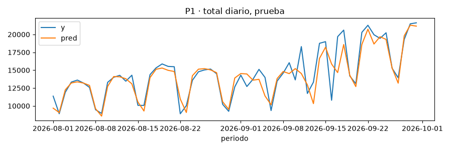
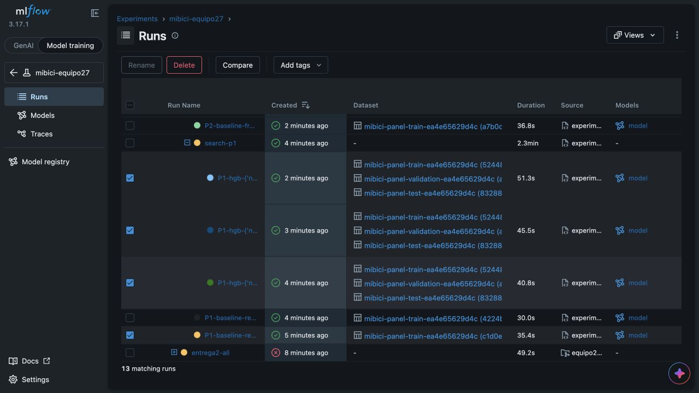
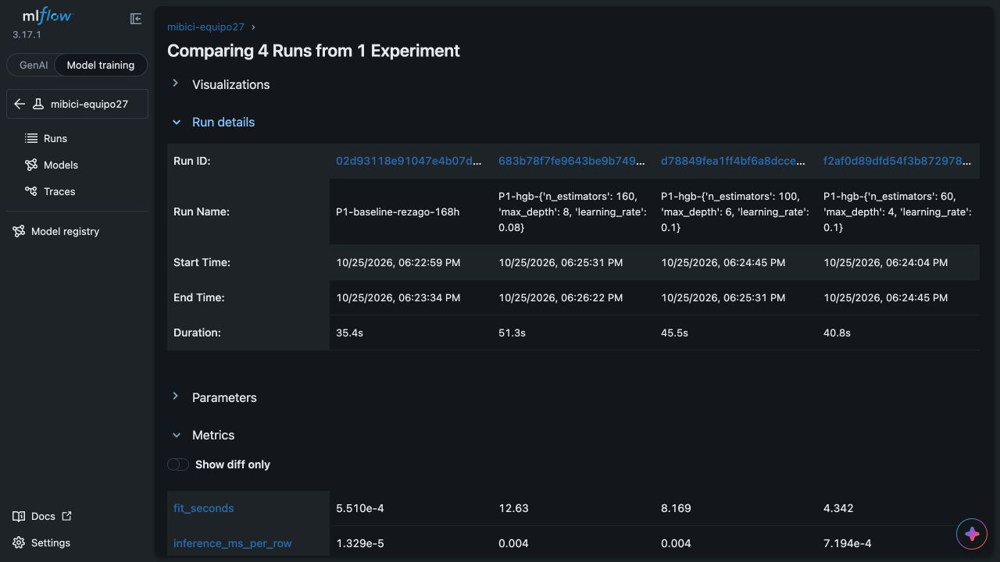
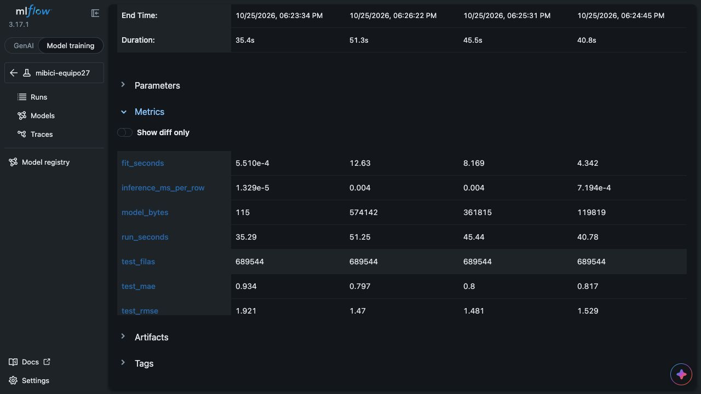
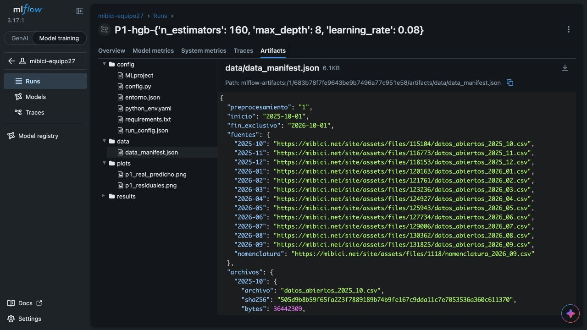
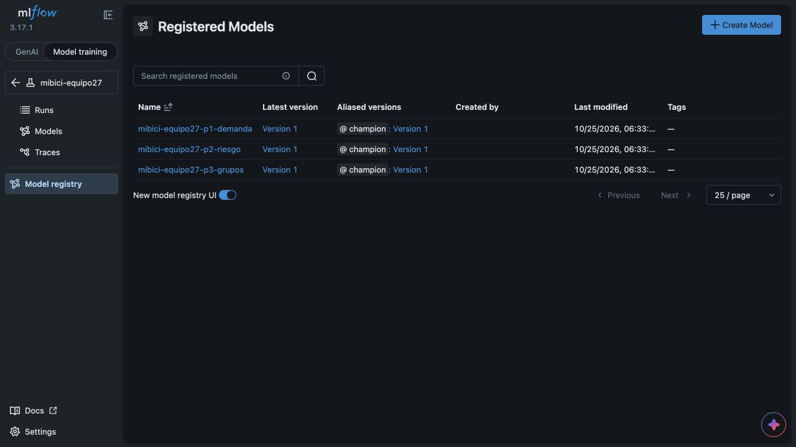
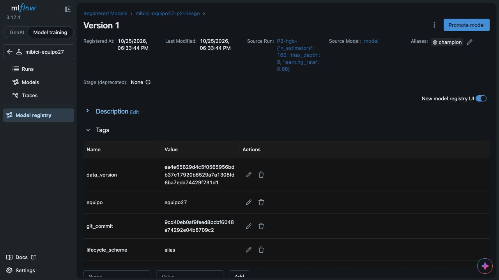
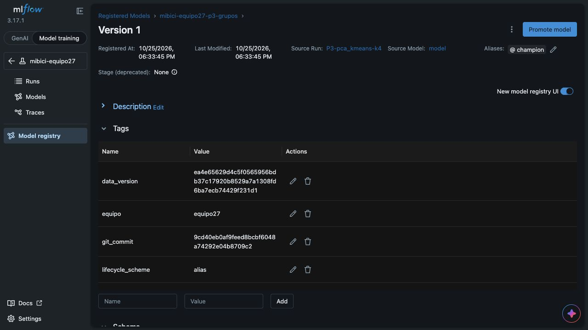

# Reporte MLflow · Equipo 27

MLflow Project y
tracking avanzado

TC5061 · MLOps · Segunda entrega · Equipo 27
Partes B y C | 25 de octubre de 2026

Versión para revisión del equipo. Implementación y evidencia local verificadas; publicación, revisión e integración de los PR pendientes. No se presenta como entrega ya enviada a Canvas.

Repositorio: https://github.com/hespinola/TC5061-Proyecto-Equipo27

| Resultado | Evidencia |
| --- | --- |
| Experimentación | 4 baselines repetidos, 9 candidatas y 3 búsquedas anidadas; todos los runs de la suite final terminaron. |
| Reproducibilidad | Paridad numérica de los cuatro baselines y misma versión de datos que la entrega anterior. |
| Registry | 3 modelos, versión 1, alias champion; carga por nombre y paridad de predicciones verificadas. |
| Validación | 50 pruebas locales; ejecución real con mlflow run y seguimiento respaldado por SQLite. |

Integrantes: Humberto Alejandro Espinola González (A01840066), Daniela Montserrat Enríquez Ballesteros (A01797865), Humberto Carrillo Gómez (A01377246), Oscar Alejandro Torres Maya (A01377686).

Se reutiliza la parte A de Dani en feat/mlflow-project. La parte B está en feat/mlflow-experiments y la parte C en feat/mlflow-registry. La evaluación individual requiere completar las contribuciones y revisiones desde las cuentas de cada integrante.

## 1. Datos, diseño y reproducibilidad

Se reutilizaron los Parquet locales de la primera entrega, verificados contra el manifiesto versionado; no se alteraron las fuentes ni se descargó una nueva versión en esta ejecución. La reconstrucción produjo 4,125,960 filas de estación por hora, 471 estaciones y 4,497,119 viajes válidos. Los datos individuales y modelos serializados no forman parte de Git.

| Partición | Periodo | Criterio |
| --- | --- | --- |
| Train | 2025-10-01 a 2026-06-30 | Ajuste de modelos, escalado y PCA. |
| Validación | 2026-07-01 a 2026-07-31 | Selección de combinación y umbral P2. |
| Prueba | 2026-08-01 a 2026-09-30 | Comparación final; nunca decide modelo o umbral. |

Los predictores de t solo usan horas anteriores a t. Se mantiene el calentamiento de 168 h. P2 excluye etiquetas cuya ventana de tres horas cruza el corte de la partición y estaciones sin capacidad válida. P1 evalúa 350,424 filas de validación y 689,544 de prueba; P2 evalúa 347,998 y 685,678, respectivamente.

Versión SHA-256 de los datos:

```bash
ea4e65629d4c5f0565956bdb37c17920
b8529a7a1308fd6ba7ecb74429f231d1
```

Commit de entrenamiento: 9cd40eb0af9feed8bcbf6048a74292e04b8709c2

Corrida Project: 580a6efc0ebd4aea97160d1a40dc1e75

Los nuevos baselines se cotejaron contra baseline_results.json de la entrega anterior, incluidas métricas y conteos, con tolerancia relativa 1e-9. El resumen enlaza cada ID nuevo con su ID original. Se conservaron los archivos históricos y los mismos nombres de métricas.

Entorno usado: Python 3.13.9, MLflow 3.17.1 y scikit-learn 1.9.1; demás versiones fijas en requirements.txt y python_env.yaml. La ejecución usó el entorno ya instalado mediante --env-manager local. No se afirma haber vuelto a instalar desde cero en esta sesión.

## 2. Comandos para reproducir

Desde un clon que incluya la rama C, con Python 3.13 y acceso a MiBici, instalar las dependencias y activar el entorno:

```bash
git clone https://github.com/hespinola/TC5061-Proyecto-Equipo27.git
cd TC5061-Proyecto-Equipo27
# Tras publicar las ramas y antes de integrarlas:
git checkout feat/mlflow-registry
python3.13 -m venv .venv
source .venv/bin/activate
python -m pip install -r tec-mlops-equipo-27/requirements.txt
python -m pip check
```

En una terminal, desde la raíz del repositorio:

```bash
mlflow server --backend-store-uri sqlite:///mlflow.db \
  --host 127.0.0.1 --port 5000
```

En otra terminal, con el mismo entorno activado:

```bash
export MLFLOW_TRACKING_URI=http://127.0.0.1:5000
export MLFLOW_EXPERIMENT_NAME=mibici-equipo27
mlflow run . -e ingest --env-manager local
mlflow run . -e experiment --env-manager local
mlflow run . -e register --env-manager local
```

Para repetir individualmente los modelos elegidos:

```bash
mlflow run . -e train --env-manager local -P question=p1 \
  -P model=hgb -P n_estimators=160 -P max_depth=8 -P learning_rate=0.08
mlflow run . -e train --env-manager local -P question=p2 \
  -P model=hgb -P n_estimators=160 -P max_depth=8 -P learning_rate=0.08
mlflow run . -e train --env-manager local -P question=p3 \
  -P model=pca_kmeans -P n_clusters=4 -P n_components=8
```

El código debe estar confirmado en Git. Los centinelas config resuelven rutas, cortes, semilla y valores por defecto desde config.py. Repetir la suite completa produce el resumen usado por register; las ejecuciones train individuales no reemplazan ese resumen. --env-manager uv crea el entorno declarado como alternativa.

## 3. P1 · Demanda por estación y hora

La métrica de selección es MAE de validación, en viajes por estación y hora. RMSE ayuda a observar errores grandes. Se comparan las dos referencias históricas y tres configuraciones de HistGradientBoostingRegressor. HGB se expresa como iteraciones/profundidad/tasa.

| Modelo / parámetros | MAE val | RMSE val | MAE test | RMSE test | Mejora MAE test |
| --- | --- | --- | --- | --- | --- |
| Baseline 168 h | 0.868982 | 1.824453 | 0.933745 | 1.921200 | +0.00% |
| Baseline 24 h | 0.910708 | 1.966678 | 1.035465 | 2.194621 | -10.89% |
| HGB 60/4/0.1 | 0.740251 | 1.402308 | 0.816955 | 1.528955 | +12.51% |
| HGB 100/6/0.1 | 0.721246 | 1.353892 | 0.799636 | 1.480837 | +14.36% |
| HGB 160/8/0.08 | 0.719212 | 1.344548 | 0.797423 | 1.469569 | +14.60% |

Se elige HGB 160/8/0.08. Reduce el MAE de validación 17.24% y el de prueba 14.60% frente al rezago semanal. Las combinaciones de 100 y 160 iteraciones están dentro del margen de casi empate del 1%; la de 160 tiene menor dispersión semanal del MAE en validación (0.020376 frente a 0.021651).

El ajuste cuesta 12.63 s frente a 8.17 s para la alternativa de 100 iteraciones. El modelo ocupa 574,142 bytes y su latencia medida fue 0.003583 ms/fila en lotes de 1,000. Se acepta este costo por la menor dispersión y el menor error; el resultado no demuestra ahorros operativos. Los totales diarios de la figura son una visualización y no sustituyen la evaluación por estación y hora.



## 4. P2 · Proxy de desequilibrio

Se maximiza average precision (AP) de validación para priorizar alertas en una clase rara. El umbral se elige por máximo F1 de validación dentro de la misma rejilla de la entrega anterior. El proxy es magnitud del flujo neto de tres horas >=50% de capacidad; no observa inventario real.

Validación

| Modelo | AP | Precisión | Recall | F1 | Umbral | Delta AP vs base |
| --- | --- | --- | --- | --- | --- | --- |
| Baseline frecuencia | 0.309132 | 0.403668 | 0.314783 | 0.353727 | 0.3 | +0.00% |
| HGB 60/4/0.1 | 0.260849 | 0.296031 | 0.263439 | 0.278786 | 0.2 | -15.62% |
| HGB 100/6/0.1 | 0.308868 | 0.358040 | 0.289628 | 0.320221 | 0.2 | -0.09% |
| HGB 160/8/0.08 | 0.314710 | 0.369333 | 0.315817 | 0.340485 | 0.2 | +1.80% |

Prueba

| Modelo | AP | Precisión | Recall | F1 | Umbral | Delta AP vs base |
| --- | --- | --- | --- | --- | --- | --- |
| Baseline frecuencia | 0.325776 | 0.453065 | 0.269737 | 0.338152 | 0.3 | +0.00% |
| HGB 60/4/0.1 | 0.279495 | 0.322827 | 0.280032 | 0.299911 | 0.2 | -14.21% |
| HGB 100/6/0.1 | 0.315856 | 0.327547 | 0.348152 | 0.337535 | 0.2 | -3.04% |
| HGB 160/8/0.08 | 0.318194 | 0.330378 | 0.371148 | 0.349578 | 0.2 | -2.33% |

Se elige HGB 160/8/0.08 con umbral 0.20: AP de validación 0.314710 frente a 0.309132 (+1.80%). No hay otra alternativa dentro del margen de casi empate del 1%. En prueba AP baja a 0.318194 frente a 0.325776 (-2.33%), pero recall sube de 0.269737 a 0.371148 y F1 de 0.338152 a 0.349578. La precisión cae de 0.453065 a 0.330378: se detectan más positivos a costa de más falsas alertas.

La selección se mantiene porque fue fijada con validación; la caída de AP en prueba impide afirmar una mejora general. El baseline sigue siendo una alternativa de menor costo y mayor precisión. La desviación semanal de AP de prueba del ganador es 0.077365, señal de variación temporal; no es un intervalo de confianza iid. Ajuste: 16.45 s; tamaño: 576,458 bytes; latencia: 0.002800 ms/fila.

La prevalencia pasa de 1.67% en validación a 2.18% en prueba. Las ventanas se solapan y no son incidentes independientes. El snapshot de capacidad de septiembre no representa su historia completa. Estos resultados respaldan una evaluación académica del proxy y no permiten cuantificar el costo del rebalanceo.

## 5. P3 · Grupos de estaciones

Baseline: K-Means, k=6 seleccionado en train. Candidatas: PCA de ocho componentes + K-Means con k=3/4/6. Escalado y PCA se ajustan solo con train. Para comparar silhouette y Davies-Bouldin se usa siempre el espacio original de 50 variables escaladas con train, incluidas las candidatas que agrupan en el espacio PCA.

| Modelo | Sil train | Sil val | Sil test | DB val | DB test | Delta Sil val |
| --- | --- | --- | --- | --- | --- | --- |
| Baseline KMeans k=6 | 0.083076 | -0.163812 | 0.079846 | 2.796635 | 2.885608 | +0.000000 |
| PCA8 + KM k=3 | 0.084754 | -0.041906 | 0.076440 | 3.734053 | 3.288847 | +0.121906 |
| PCA8 + KM k=4 | 0.085674 | -0.041906 | 0.076440 | 3.734053 | 3.288847 | +0.121906 |
| PCA8 + KM k=6 | 0.051748 | -0.209371 | 0.049053 | 3.307668 | 3.141645 | -0.045559 |

| Modelo | ARI semillas medio | ARI semillas mínimo | ARI temporal val | ARI temporal test |
| --- | --- | --- | --- | --- |
| Baseline KMeans k=6 | 0.452768 | 0.439921 | 0.470257 | 0.546885 |
| PCA8 + KM k=3 | 0.845614 | 0.751318 | 0.395780 | 0.500452 |
| PCA8 + KM k=4 | 0.782277 | 0.782277 | 0.395737 | 0.500362 |
| PCA8 + KM k=6 | 0.735976 | 0.643189 | 0.350984 | 0.377656 |

P3 no tenía validación/prueba temporal en la primera entrega: se añade este diagnóstico, manteniendo las métricas originales de train y sus valores. La comparación entre periodos usa las estaciones válidas comunes con train: 424 en train y 422 en validación/prueba. Coordenadas solo se utilizan en el mapa.

Se elige PCA8 + K-Means k=4. Su silhouette de validación (-0.041906) supera al baseline (-0.163812) en 0.121906 puntos. k=3 empata en silhouette; k=4 gana por ARI mínimo entre semillas (0.782277 frente a 0.751318). Se comparan semillas 42, 43 y 44. El silhouette de prueba es 0.076440 frente a 0.079846 del baseline: no mejora en todas las métricas.

La separación negativa en validación y ARI temporal de 0.395737 muestran que la segmentación no está consolidada. Se registra champion para el ciclo de vida académico, con esta limitación explícita. Antes de usar grupos para decisiones reales deben revisarse perfiles, estacionalidad y cobertura de estaciones. Ajuste: 0.0098 s; tamaño: 9,369 bytes; latencia: 0.001233 ms/fila.

## 6. Artefactos, selección y ciclo de vida

Cada corrida conserva etiquetas question, model_family, stage_of_work, equipo, git_commit y data_version. La suite tiene una corrida Project, cuatro hijas baseline y tres padres search-pN, cada uno con tres hijas candidatas. El intento inicial fallido de serialización permanece visible en MLflow y no pertenece a la suite final usada para seleccionar.

| Ubicación | Contenido |
| --- | --- |
| Modelo MLflow 3 | Estimador completo, firma, ejemplo numérico y dependencias; enlazado a la corrida mediante model_uri. |
| config/ | run_config.json, entorno.json, config.py, MLproject, python_env.yaml y requirements.txt. |
| data/ e inputs | Manifiesto de ingesta; esquema y digest de datasets agregados mediante log_input. |
| plots/ | P1: real/predicho y residuales. P2: confusión y precisión-recall. P3: mapa y perfiles horarios. |
| results/ | Resumen, selección de umbral, estabilidad semanal o diagnósticos de grupos. |

Se usan aliases en lugar de etapas clásicas: champion es una referencia estable a una versión y permite cambiar la versión de consumo sin modificar el nombre usado por los clientes (MLflow, s. f.-e). La etapa clásica aparece como None porque la producción de esta entrega se expresa con el alias.

models:/mibici-equipo27-p1-demanda@champion · versión 1

models:/mibici-equipo27-p2-riesgo@champion · versión 1

models:/mibici-equipo27-p3-grupos@champion · versión 1

El registro valida artefactos, inputs, experimentos, cortes, métricas y linaje. Reutiliza una versión que ya provenga de la misma corrida. Comprueba predicciones por URI de origen, por número de versión y por alias usando el ejemplo guardado. Si falla la comprobación posterior al cambio de alias, restaura el anterior para ese modelo. No constituye una transacción conjunta de tres aliases.

Las tres cargas por alias y las tres paridades fueron verificadas con cinco entradas de ejemplo por modelo. Esto comprueba integración y contrato de entrada; no sustituye una evaluación con tráfico real. No se desplegó un endpoint de inferencia ni se inventó evidencia de producción operativa.

## 7. Linaje y colaboración pendiente

mibici-equipo27-p1-demanda · v1 @champion

Run origen: 683b78f7fe9643be9b7496a77c951e58

mibici-equipo27-p2-riesgo · v1 @champion

Run origen: 8f8989795a434fb8960b4f4ce13fa9cb

mibici-equipo27-p3-grupos · v1 @champion

Run origen: 5a0f7131eee545758051e4411542af0e

Experimento: mibici-equipo27. Commit común de entrenamiento: 9cd40eb0af9feed8bcbf6048a74292e04b8709c2

Commit que ejecutó la promoción: 24e7852b25a16292b4967009a60c515a0ff43ee2

Run de registro verificado: 39e56e8397a744138f03d57715ce5d45

La versión de datos completa coincide con la mostrada en la sección 1. Los archivos experiment_results.json y registry_results.json conservan los IDs íntegros, las métricas y los criterios de selección. La base SQLite y mlartifacts se conservan solo en la copia de trabajo local y deben reconstruirse al reproducir desde Git.

| PR propuesto | Rama base | Estado de esta copia |
| --- | --- | --- |
| Parte A | main | Rama de Dani: feat/mlflow-project, usada como base. |
| Parte B | feat/mlflow-project | feat/mlflow-experiments; commits y texto de PR preparados localmente. |
| Parte C | feat/mlflow-experiments | feat/mlflow-registry; commits, reporte y texto de PR preparados localmente. |

La publicación de la rama fue rechazada en el permiso solicitado durante esta sesión. No se abrieron ni revisaron PR en nombre de nadie. Los textos de PR explican los destinos encadenados; después de integrar la base debe actualizarse el destino de los siguientes a main. No se modificó la rama principal.

Antes de la entrega en Canvas: publicar las ramas, abrir y revisar los PR, verificar que cada uno de los cuatro integrantes tenga al menos un PR y una revisión en esta entrega, integrar por la rama protegida y confirmar acceso del profesor. El historial colaborativo aún no está certificado por este reporte.

## 8. Evidencia · búsquedas anidadas

Captura real de MLflow: jerarquía de la búsqueda de P1 y sus tres combinaciones. La ejecución estaba en curso al tomar esta vista; el resumen final documenta que todos los runs de la suite terminaron.



## 9. Evidencia · comparación contra baseline

Comparación real de cuatro runs en el mismo experimento: baseline semanal y tres configuraciones HGB. Los valores completos están en la tabla de P1 y en el JSON de resultados.





## 10. Evidencia · artefactos y datos

Corrida candidata de P1: configuración, manifiesto de datos y gráficas organizadas por carpeta. MLflow 3 presenta el modelo en Logged models, enlazado a esta corrida.



## 11. Evidencia · tres modelos en producción

Los tres modelos aparecen en Model Registry con versión 1 y alias champion.



## 12. Evidencia · linaje de P1

La versión de P1 conserva corrida origen, alias, commit y versión de datos.


## 13. Evidencia · linaje de P2

La versión de P2 conserva corrida origen, alias, commit y versión de datos; el estimador incluye umbral 0.20.



## 14. Evidencia · linaje de P3

La versión de P3 conserva corrida origen, alias, commit y versión de datos; la descripción limita su interpretación operativa.



## 15. Referencias

Equipo 27. (2026). *TC5061-Proyecto-Equipo27*. [Repositorio de código y manifiesto de datos]. GitHub. https://github.com/hespinola/TC5061-Proyecto-Equipo27

MLflow. (s. f.-a). *MLflow Dataset Tracking*. Recuperado el 25 de octubre de 2026, de https://mlflow.org/docs/latest/ml/dataset/

MLflow. (s. f.-b). *MLflow Projects*. Recuperado el 25 de octubre de 2026, de https://mlflow.org/docs/latest/ml/projects/

MLflow. (s. f.-c). *mlflow.sklearn*. Recuperado el 25 de octubre de 2026, de https://mlflow.org/docs/latest/api_reference/python_api/mlflow.sklearn.html

MLflow. (s. f.-d). *MLflow Tracking APIs*. Recuperado el 25 de octubre de 2026, de https://mlflow.org/docs/latest/ml/tracking/tracking-api/

MLflow. (s. f.-e). *Model Registry Workflows*. Recuperado el 25 de octubre de 2026, de https://mlflow.org/docs/latest/ml/model-registry/workflow/

MLflow Projects respalda el empaquetado y los puntos de entrada (s. f.-b); Tracking APIs, el registro explícito de métricas y corridas (s. f.-d); Dataset Tracking, el linaje de inputs (s. f.-a); Model Registry Workflows, aliases y almacenamiento con base de datos (s. f.-e); y mlflow.sklearn, el registro del modelo con firma y ejemplo (s. f.-c). Las cifras y conclusiones del reporte derivan de las ejecuciones locales del equipo, no de la documentación.

Archivos de evidencia: reports/experiment_results.json, reports/registry_results.json, reports/baseline_results.json, references/data_manifest.json y reports/figures/entrega2/.
